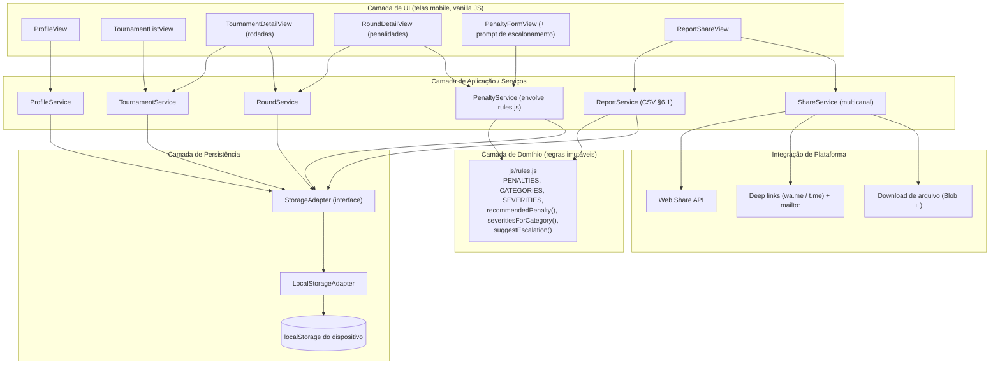
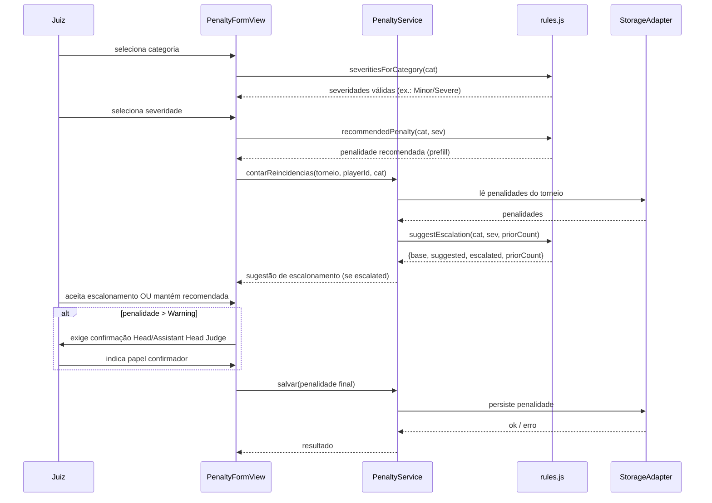
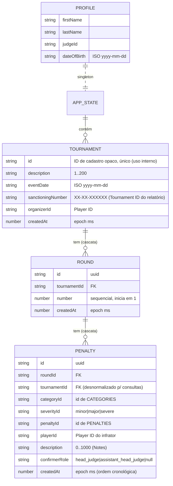

# Design Document

## Overview

O **Pokémon Judge Penalty Tracker** é uma aplicação web **client-side**, *offline-first* e otimizada para celular, que apoia juízes de torneios Pokémon no registro de penalidades por rodada e na geração/compartilhamento do *Tournament Penalty Summary* (CSV, §6.1) ao final do evento.

Decisões arquiteturais centrais:

- **Sem backend.** Todo o estado (perfil, torneios, rodadas, penalidades) é persistido no armazenamento local do dispositivo. A rede só é necessária no passo final de compartilhamento (Requisitos 10.4, 10.7).
- **Reuso do domínio existente.** O módulo `js/rules.js` já encapsula as regras do *Penalty Guidelines* (conjunto fechado de penalidades, severidades, categorias, penalidade recomendada e escalonamento por reincidência). O design **constrói sobre** esse módulo em vez de reimplementar essas regras. Toda sugestão de penalidade e escalonamento passa por `recommendedPenalty()`, `severitiesForCategory()` e `suggestEscalation()`.
- **Baixa dependência.** A aplicação usa **JavaScript vanilla com ES Modules**, sem framework nem build obrigatório, para rodar diretamente a partir de arquivos estáticos (adequado a uso em evento ao vivo, com instalação simples e sem toolchain). Essa escolha mantém `rules.js` utilizável sem adaptação. Um bundler/minificador é opcional e não altera a arquitetura.
- **Camadas explícitas.** A UI é fina; a lógica fica em serviços de aplicação; o domínio vive em `rules.js`; a persistência é isolada atrás de um `StorageAdapter`. Isso torna o domínio e os serviços testáveis (incluindo testes baseados em propriedades) sem DOM nem armazenamento real.

Fontes de regra citadas: *Play! Pokémon Penalty Guidelines* §3 (conjunto fechado), §4.4.2 (escalonamento), §5 (categorias e penalidades recomendadas), §6.1 (CSV); *Tournament Rules Handbook* cap. 7 (confirmação do Head Judge). Essas regras já estão codificadas em `js/rules.js`.

## Architecture

A aplicação segue uma arquitetura em camadas. A UI despacha intenções do usuário para serviços de aplicação; os serviços aplicam regras consultando o módulo de domínio (`rules.js`) e persistem o resultado através de uma abstração de armazenamento. O domínio não conhece UI nem armazenamento; o armazenamento não conhece regras.



### Fluxo de dados — registro de uma penalidade

Este fluxo mostra como o registro de penalidade combina domínio (`rules.js`), reincidência e confirmação do Head Judge (Requisitos 4, 5, 6, 7).



### Princípios da arquitetura

- **UI fina / lógica nos serviços.** As views apenas renderizam estado e emitem intenções; validação e regras ficam nos serviços. Isso satisfaz o Requisito 11 (seletores de valores predefinidos) sem acoplar regras ao DOM.
- **Domínio puro e imutável.** `rules.js` só contém funções puras e dados constantes — ideal para testes baseados em propriedades (Requisitos 5 e 6).
- **Armazenamento isolado.** Trocar `localStorage` por `IndexedDB` no futuro afeta apenas o `LocalStorageAdapter`. O design adota `localStorage` por simplicidade; o volume esperado (um torneio tem dezenas a poucas centenas de penalidades) está muito abaixo do limite típico (~5 MB).
- **Offline por padrão.** Nenhuma operação de leitura/escrita de dados depende de rede (Requisito 10.4, 10.7).

## Components and Interfaces

As assinaturas abaixo usam notação TypeScript apenas para clareza; a implementação é JS vanilla. Todos os serviços recebem um `StorageAdapter` por injeção, o que permite testá-los com um adaptador em memória.

### StorageAdapter (abstração de persistência)

Isola as camadas superiores do mecanismo concreto de armazenamento e normaliza erros (indisponível, quota, corrompido) — Requisitos 10.2, 10.3, 10.6.

```ts
interface StorageAdapter {
  // Lê e desserializa a raiz do estado. Lança StorageCorruptedError se o
  // conteúdo existir mas não puder ser interpretado (Req 10.6).
  load(): AppState;

  // Serializa e grava a raiz do estado. Lança StorageQuotaError (Req 10.3)
  // ou StorageWriteError (Req 10.2) em caso de falha.
  save(state: AppState): void;

  isAvailable(): boolean; // feature-detection de localStorage
}

class LocalStorageAdapter implements StorageAdapter { /* usa window.localStorage */ }
class MemoryStorageAdapter implements StorageAdapter { /* usado em testes */ }
```

Padrão de persistência: todos os serviços operam sobre um **AppState** carregado uma vez e persistido por completo a cada mutação confirmada (gravação atômica da raiz). Isso simplifica a consistência referencial entre torneios/rodadas/penalidades e satisfaz "persistir em até 2 s" (Req 10.1) com folga, dado o volume de dados.

### ProfileService

Requisitos 1.1–1.7.

```ts
interface ProfileService {
  getProfile(): Profile | null;                 // Req 1.6
  saveProfile(input: ProfileInput): Result<Profile, ValidationError[]>; // Req 1.1–1.5
}
// Validações: campos obrigatórios não-vazios (1.2); dob <= hoje (1.3);
// nome/sobrenome <= 50, judgeId <= 20 (1.4). Em erro, não persiste e
// retorna a lista de campos inválidos; a view preserva o que foi digitado.
```

### TournamentService

Requisitos 2.1–2.14.

```ts
interface TournamentService {
  list(): TournamentSummary[];                  // Req 2.7 (sancionamento, descrição, data)
  get(id: string): Tournament | null;           // Req 2.8
  create(input: TournamentInput): Result<Tournament, ValidationError[]>; // 2.1–2.6
  update(id: string, input: TournamentInput): Result<Tournament, ValidationError[]>; // 2.9, 2.10
  delete(id: string, confirmed: boolean): Result<void, Error>; // 2.11, 2.12 (cascata)
}

// generateRecordId(): string -> ID de cadastro OPACO de uso interno (não vai ao
//   relatório), sem exigência de formato. create() regenera enquanto colidir (2.13, 2.14).
// O FORMATO XX-XX-XXXXXX aplica-se ao sanctioningNumber (Tournament ID do
//   relatório), que é VALIDADO (não gerado) na entrada do juiz (2.2).
```

- `create`/`update` validam: descrição 1–200 (2.3), número de sancionamento no formato `XX-XX-XXXXXX` (2.2), campos obrigatórios (2.5), data válida (2.6). `update` mantém o ID de cadastro (2.10).
- `delete` com `confirmed=false` não altera nada (2.12); com `confirmed=true` remove torneio + rodadas + penalidades em cascata (2.11).

### RoundService

Requisitos 3.1–3.10.

```ts
interface RoundService {
  listByTournament(tournamentId: string): Round[]; // ordenado por number asc (3.4)
  addRound(tournamentId: string): Result<Round, Error>; // 3.2, 3.3
  getPenalties(roundId: string): Penalty[];        // 3.6, 3.7
  deleteRound(roundId: string, confirmed: boolean): Result<void, Error>; // 3.8–3.10
}
// addRound: number = (max(number) das rodadas do torneio) + 1; 1 se não houver (3.2, 3.3).
// deleteRound(confirmed=true) remove a rodada e suas penalidades (3.9).
```

### PenaltyService (envolve rules.js)

Requisitos 4, 5, 6, 7. É o principal ponto de integração com o domínio.

```ts
interface PenaltyService {
  // Severidades válidas para a categoria (delega a severitiesForCategory).
  severityOptions(categoryId: string): Severity[]; // Req 4.5, 5.6/5.7/5.11

  // Penalidade recomendada para (categoria, severidade) — prefill editável.
  recommendedFor(categoryId: string, severityId: string): PenaltyId | null; // Req 4.9, 5.*

  // Conta penalidades anteriores (mesma categoria + mesmo playerId no torneio)
  // e consulta suggestEscalation(). Retorna a sugestão para a UI.
  evaluateEscalation(args: {
    tournamentId: string; playerId: string;
    categoryId: string; severityId: string;
  }): EscalationSuggestion; // Req 6.1–6.6

  // Persiste a penalidade. Rejeita se a combinação (cat, sev) for inválida
  // (4.8), se faltar campo (4.7), ou se > Warning sem confirmação (7.1, 7.2).
  record(input: PenaltyInput): Result<Penalty, ValidationError[]>;
}

type EscalationSuggestion = {
  base: PenaltyId;          // recomendada inicial
  suggested: PenaltyId;     // escalada (teto Disqualification)
  escalated: boolean;       // true só quando priorCount>=1 e categoria escala
  priorCount: number;
};
```

Delegação ao domínio (nenhuma regra duplicada):

- `severityOptions` -> `severitiesForCategory(categoryId)`.
- `recommendedFor` -> `recommendedPenalty(categoryId, severityId)`.
- `evaluateEscalation` conta os prévios (`penalties` do torneio filtrados por `categoryId` e `playerId`) e chama `suggestEscalation(categoryId, severityId, priorCount)`. Como `rules.js` já trata Cheating (`escalates:false`) e o teto (`Math.min(baseRank+priorCount, maxRank)`), os Requisitos 6.3, 6.4 e 6.5 são atendidos pelo domínio.

Regras de confirmação do Head Judge (Requisito 7) — definidas sobre o conjunto fechado:

- Uma penalidade "acima de Warning" é aquela cujo `PENALTY_RANK[penaltyId] > PENALTY_RANK["warning"]`, isto é: Double Prize Loss, Quadruple Prize Loss, Game Loss, Match Loss, Disqualification.
- Para essas, `confirmerRole` (`"head_judge"` | `"assistant_head_judge"`) é obrigatório; ausência rejeita o registro (7.2) e é gravado junto à penalidade quando presente (7.4). Caution/Warning não exigem confirmação (7.3).

### ReportService (CSV §6.1)

Requisitos 8.1–8.8.

```ts
interface ReportService {
  // Monta as linhas reportáveis (exclui Caution), ordena e serializa em CSV.
  // Recebe o ID de cadastro para localizar o torneio; a coluna/assunto usam o
  // sanctioningNumber do torneio como "Tournament ID".
  generateCsv(recordId: string): { csv: string; reportableCount: number }; // 8.1–8.6, 8.8
  emailSubject(recordId: string): string; // "Penalty Report: <sanctioningNumber>" (8.7)
}
```

- Cabeçalho fixo e ordenado (8.1): `Tournament ID, Round of Issue, Judge Player ID, Competitor's Player ID, Category, Severity, Penalty, Notes`.
- Reportável = `PENALTIES.find(p => p.id === penalty.penaltyId).reportable` (Caution tem `reportable:false`) — Requisitos 8.2, 8.3.
- Mapeamento de colunas conforme 8.4: a coluna **`Tournament ID` recebe o `sanctioningNumber`** do torneio (não o ID de cadastro interno); `Notes` vazio quando não há descrição.
- Ordenação: `Round of Issue` asc e, dentro da rodada, ordem cronológica de emissão (`createdAt`/sequência de inserção) — Requisito 8.5.
- Escape CSV (8.6): se o valor contém `,`, `"` ou quebra de linha, envolver em aspas duplas e duplicar aspas internas. Rótulos legíveis vêm de `categoryLabel()`, `severityLabel()`, `penaltyLabel()`.
- Sem reportáveis -> somente a linha de cabeçalho e `reportableCount=0`, para a UI avisar (8.8).

### ShareService (compartilhamento multicanal)

Requisitos 9.1–9.7. Estratégia em cascata: **Web Share API** quando disponível; senão **deep link / mailto**; e **download de CSV** como último recurso (9.6).

```ts
type Channel = "whatsapp" | "telegram" | "email";

interface ShareService {
  availableChannels(): Channel[];      // feature-detection (9.1)
  share(channel: Channel, payload: SharePayload): Promise<ShareResult>; // 9.2–9.6
  downloadCsv(payload: SharePayload): void; // 9.7 (Blob + <a download>)
}

type SharePayload = { tournamentId: string; subject: string; csv: string };
```

- **WhatsApp**: `navigator.share({ text })` se suportado; senão `https://wa.me/?text=<csv-encode>` (9.2).
- **Telegram**: Web Share se suportado; senão `https://t.me/share/url?url=&text=<csv-encode>` (9.3).
- **E-mail**: `mailto:?subject=Penalty%20Report:%20XX-XX-XXXXXX&body=<csv>` (9.4). Se o assunto não puder ser montado, mensagem de falha e relatório segue disponível (9.5).
- **Fallback universal**: canal indisponível -> mensagem + oferta de download do CSV (9.6, 9.7).

## Data Models

Quatro entidades principais com relacionamentos de composição: um Torneio tem muitas Rodadas; uma Rodada tem muitas Penalidades. O Perfil é um registro único (singleton) do dispositivo. Categoria, severidade e penalidade **não** são entidades persistidas — são valores do conjunto fechado definido em `rules.js` (apenas os ids são armazenados).



Observações de modelagem:

- `PENALTY.tournamentId` é desnormalizado (além de `roundId`) para que a contagem de reincidências (Req 6.1) e a geração do CSV (Req 8) sejam diretas por torneio, sem recompor a árvore.
- `categoryId`/`severityId`/`penaltyId` guardam apenas o id do conjunto fechado; os rótulos exibidos/reportados vêm de `rules.js` em tempo de leitura. Isso impede valores fora do conjunto (Requisitos 4.2–4.4, 11.3, 11.4).
- `confirmerRole` só é não-nulo para penalidades acima de Warning (Req 7.4).
- Datas armazenadas como string ISO `yyyy-mm-dd`; `createdAt` numérico garante ordem cronológica estável para o CSV (Req 8.5).

### Esquema de localStorage e versionamento

Uma única chave raiz guarda todo o AppState serializado em JSON, com um número de versão de esquema para futuras migrações.

```
Chave: "pjpt.appState"      // raiz única, JSON
Chave: "pjpt.schemaVersion" // inteiro, atualmente 1
```

```ts
type AppState = {
  schemaVersion: 1;
  profile: Profile | null;
  tournaments: Tournament[];
  rounds: Round[];       // referenciam tournamentId
  penalties: Penalty[];  // referenciam roundId + tournamentId
};
```

- **Gravação atômica**: `StorageAdapter.save()` serializa o `AppState` inteiro e grava de uma vez. Em `QuotaExceededError`, nada é sobrescrito e um `StorageQuotaError` é propagado (Req 10.3).
- **Carregamento tolerante a falhas**: no boot, `load()` lê e faz `JSON.parse`. Se o parse falhar ou o `schemaVersion` for incompatível/ausente, a aplicação inicia com estado vazio e **não** sobrescreve a chave original, exibindo aviso (Req 10.6).
- **Migração**: ao evoluir o esquema, `schemaVersion` incrementa e `load()` aplica migração antes de usar o estado.

## Correctness Properties


*Uma propriedade é uma característica ou comportamento que deve ser verdadeiro em todas as execuções válidas do sistema — essencialmente, uma afirmação formal sobre o que o sistema deve fazer. Propriedades servem de ponte entre especificações legíveis por humanos e garantias de correção verificáveis por máquina.*

As propriedades abaixo são universais ("para todo/qualquer…") e destinam-se a testes baseados em propriedades. A lógica de domínio (`rules.js`), a persistência (via `MemoryStorageAdapter`) e a geração de CSV são puras ou isoláveis, o que as torna adequadas a PBT. Comportamentos de UI/CSS e integrações de rede/plataforma ficam fora destas propriedades (ver Testing Strategy).

### Property 1: Round-trip de persistência do estado

*Para qualquer* AppState válido, gravá-lo via `StorageAdapter.save()` e em seguida carregá-lo via `load()` produz um estado estruturalmente igual ao original (perfil, torneios, rodadas e penalidades preservados).

**Validates: Requirements 1.1, 1.5, 10.5**

### Property 2: Campos obrigatórios não podem ser vazios

*Para qualquer* entidade (perfil, torneio ou penalidade) em que ao menos um campo obrigatório seja ausente ou composto apenas por espaços em branco, a operação de salvar é rejeitada, nada é persistido e os valores informados são preservados.

**Validates: Requirements 1.2, 2.5, 4.7**

### Property 3: Limites de comprimento de campos

*Para qualquer* valor de campo com restrição de comprimento (nome/sobrenome ≤ 50, Judge ID ≤ 20, descrição do torneio 1–200, número de sancionamento 1–50, descrição da penalidade 1–1000), a validação aceita o valor se, e somente se, o comprimento estiver dentro do intervalo permitido.

**Validates: Requirements 1.4, 2.3, 2.4, 4.6**

### Property 4: Data de nascimento futura é inválida

*Para qualquer* data de nascimento estritamente posterior à data atual do dispositivo, o salvamento do perfil é rejeitado e os dados informados são preservados.

**Validates: Requirements 1.3**

### Property 5: Validação do formato do Número de Sancionamento

*Para qualquer* valor de número de sancionamento informado, a criação/edição do torneio é aceita se, e somente se, o valor casar com o padrão `XX-XX-XXXXXX` (regex `^[A-Za-z0-9]{2}-[A-Za-z0-9]{2}-[A-Za-z0-9]{6}$`). O sanctioningNumber é o valor usado como `Tournament ID` no relatório; o ID de cadastro interno não tem exigência de formato.

**Validates: Requirements 2.2**

### Property 6: Unicidade dos identificadores de torneio

*Para qualquer* sequência de criações de torneio no mesmo dispositivo, todos os identificadores resultantes são distintos entre si; se um identificador gerado colidir com um existente, um novo é gerado até ser distinto.

**Validates: Requirements 2.13, 2.14**

### Property 7: Edição de torneio preserva o identificador

*Para qualquer* torneio existente e qualquer entrada de edição válida, após a atualização o identificador do torneio permanece inalterado.

**Validates: Requirements 2.10**

### Property 8: Exclusão em cascata e confirmação

*Para qualquer* estado com um torneio e suas rodadas e penalidades, excluir o torneio com confirmação remove o torneio e todas as suas rodadas e penalidades; excluir sem confirmação (cancelado) deixa o estado inalterado. O mesmo vale para a exclusão de rodada em relação às suas penalidades.

**Validates: Requirements 2.11, 2.12, 3.9, 3.10**

### Property 9: Numeração sequencial e contígua das rodadas

*Para qualquer* torneio ao qual sejam adicionadas k rodadas em sequência, os números atribuídos são exatamente 1, 2, …, k, e a listagem das rodadas é ordenada de forma crescente por esse número.

**Validates: Requirements 3.2, 3.3, 3.4**

### Property 10: Severidades oferecidas correspondem às válidas da categoria

*Para qualquer* categoria, as severidades oferecidas como selecionáveis são exatamente aquelas que possuem penalidade recomendada definida em §5; em particular, Gameplay Error (VG), Gameplay Error (GO) e Pace of Play oferecem somente Minor e Severe.

**Validates: Requirements 4.5, 5.6, 5.7, 5.11**

### Property 11: Toda combinação válida tem penalidade recomendada definida

*Para qualquer* categoria e qualquer severidade válida dessa categoria, a penalidade inicial recomendada é um valor definido pertencente ao conjunto fechado de penalidades (prefill), e o campo permanece editável para qualquer valor desse conjunto.

**Validates: Requirements 4.9, 5.1, 5.2, 5.3, 5.4, 5.5, 5.8, 5.9, 5.10**

### Property 12: Combinação de categoria e severidade inválida é rejeitada

*Para qualquer* par (categoria, severidade) sem penalidade recomendada em §5, o registro da penalidade é rejeitado, nada é persistido e os valores informados são preservados.

**Validates: Requirements 4.8**

### Property 13: Contagem de reincidência é escopada

*Para qualquer* conjunto de penalidades registradas, a contagem de prévios usada no escalonamento considera exatamente as penalidades da mesma categoria, do mesmo Player ID infrator e do mesmo torneio.

**Validates: Requirements 6.1**

### Property 14: Escalonamento eleva um nível por prévio, com teto em Disqualification

*Para qualquer* categoria que admite escalonamento, severidade válida e contagem de prévios `n ≥ 0`, a penalidade sugerida tem posto `min(postoBase + n, posto(Disqualification))`; o resultado nunca ultrapassa Disqualification e, quando `n = 0`, mantém a recomendada sem sinalizar escalonamento.

**Validates: Requirements 6.3, 6.4, 6.6**

### Property 15: Cheating nunca escala

*Para qualquer* severidade e qualquer contagem de prévios, a categoria Cheating mantém Disqualification como penalidade recomendada e não sinaliza escalonamento.

**Validates: Requirements 6.5**

### Property 16: Confirmação obrigatória acima de Warning

*Para qualquer* penalidade cujo posto seja superior ao de Warning (Double Prize Loss, Quadruple Prize Loss, Game Loss, Match Loss, Disqualification), o registro é rejeitado se o papel confirmador (Head Judge ou Assistant Head Judge) não for indicado, e concluído quando indicado; para Caution e Warning, o registro conclui sem exigir confirmação. Quando indicado, o papel confirmador é persistido junto à penalidade.

**Validates: Requirements 7.1, 7.2, 7.3, 7.4**

### Property 17: Cabeçalho do CSV fixo e ordenado

*Para qualquer* torneio, a primeira linha do CSV é exatamente `Tournament ID,Round of Issue,Judge Player ID,Competitor's Player ID,Category,Severity,Penalty,Notes`.

**Validates: Requirements 8.1**

### Property 18: CSV contém exatamente as penalidades reportáveis e nenhuma Caution

*Para qualquer* conjunto de penalidades de um torneio, o número de linhas de dados do CSV é igual ao número de penalidades cujo tipo não é Caution, e nenhuma linha corresponde a uma penalidade Caution; quando não há penalidades reportáveis, o CSV contém apenas a linha de cabeçalho.

**Validates: Requirements 8.2, 8.3, 8.8**

### Property 19: Mapeamento correto das colunas do CSV

*Para qualquer* penalidade reportável, a linha correspondente preenche `Tournament ID` com o número de sancionamento do torneio, `Round of Issue` com o número da rodada, `Judge Player ID` com o Judge ID do perfil, `Competitor's Player ID` com o Player ID do infrator, `Category`/`Severity`/`Penalty` com os rótulos correspondentes e `Notes` com a descrição (vazio quando ausente).

**Validates: Requirements 8.4, 1.7**

### Property 20: Ordenação das linhas do CSV

*Para qualquer* conjunto de penalidades reportáveis, as linhas de dados do CSV aparecem em ordem crescente de `Round of Issue` e, dentro de uma mesma rodada, em ordem cronológica de emissão.

**Validates: Requirements 8.5**

### Property 21: Escape de CSV round-trip

*Para qualquer* valor de campo contendo vírgula, aspas duplas e/ou quebra de linha, o valor serializado é envolvido em aspas duplas com aspas internas duplicadas, de modo que reparsear o CSV recupera exatamente os valores originais de todos os campos.

**Validates: Requirements 8.6**

### Property 22: Formato do assunto de e-mail

*Para qualquer* torneio, o assunto gerado é exatamente `Penalty Report: ` seguido do número de sancionamento (Tournament ID) do torneio.

**Validates: Requirements 8.7**

## Error Handling

A estratégia de erros distingue **erros de validação** (esperados, exibidos ao usuário sem perder o que foi digitado) de **erros de infraestrutura** (armazenamento/plataforma, normalizados pelo adapter).

- **Validação de formulários (Req 1.2–1.4, 2.3–2.6, 4.6–4.8, 7.2).** Serviços retornam `Result<T, ValidationError[]>`. Em erro: nada é persistido, a view mantém os valores digitados e exibe mensagem apontando o campo (faltante, fora do limite, data inválida, combinação inválida, ou confirmação ausente).
- **Falha de escrita no armazenamento (Req 10.2).** `StorageAdapter.save()` lança `StorageWriteError`; o serviço não altera o estado em memória exibido e a UI mostra "a alteração não foi salva".
- **Quota excedida (Req 10.3).** `QuotaExceededError` é mapeado para `StorageQuotaError`; a gravação é abortada **antes** de sobrescrever (gravação atômica da raiz), preservando os dados já armazenados, e a UI informa falta de espaço.
- **Dados corrompidos/ausentes no boot (Req 10.6).** `load()` captura falhas de `JSON.parse` e versões incompatíveis, retorna estado vazio e **não** regrava a chave, exibindo aviso de que os dados não puderam ser restaurados. A chave original fica intacta para eventual recuperação.
- **Assunto de e-mail não montável (Req 9.5).** `ShareService` detecta falha ao compor o assunto, exibe mensagem e mantém o relatório disponível para novo compartilhamento.
- **Canal indisponível (Req 9.6).** Feature-detection negativa leva a mensagem de indisponibilidade e oferta de download do CSV como alternativa.
- **Valor fora do conjunto fechado (Req 4.2–4.4, 11.4).** A UI usa `<select>` (sem texto livre) e o serviço revalida o id contra `rules.js`, rejeitando ids externos e preservando a seleção anterior.

Mensagens de erro são curtas, específicas do campo/causa e exibidas inline próximas ao controle afetado, respeitando a usabilidade móvel.

## Testing Strategy

Abordagem dupla: **testes baseados em propriedades** para a lógica de domínio/relatório (correção universal) e **testes por exemplo/integração** para casos específicos, bordas, erros e integrações de plataforma. Ambientes de teste rodam sem rede, o que também valida a operação offline da lógica (Req 10.4, 10.7).

### Testes baseados em propriedades (PBT)

- **Biblioteca:** usar **fast-check** (padrão de PBT para JavaScript/ES Modules). Não implementar PBT do zero.
- **Configuração:** mínimo de **100 iterações** por propriedade (`fc.assert(fc.property(...), { numRuns: 100 })`).
- **Rastreabilidade:** cada teste de propriedade recebe um comentário no formato **Feature: pokemon-judge-penalty-tracker, Property {n}: {texto da propriedade}** e implementa uma única propriedade do documento.
- **Alvos:** Propriedades 1–22. O domínio (`rules.js`) é testado diretamente (Propriedades 10, 11, 14, 15); serviços são testados com `MemoryStorageAdapter` injetado (Propriedades 1–9, 12, 13, 16); o `ReportService` é testado como serializer puro, incluindo um round-trip de escape de CSV com um parser CSV de referência (Propriedades 17–22).
- **Geradores:** arbitrários para perfis, torneios, rodadas e penalidades válidos/ inválidos; para a Propriedade 21, geradores de strings contendo vírgulas, aspas e quebras de linha; para a Propriedade 10, enumerar todas as categorias de `CATEGORIES`.

### Testes por exemplo (unitários)

- Valores exatos da tabela de penalidades recomendadas (§5.1–§5.11) como exemplos pontuais (ex.: `cheating→disqualification`, `tardiness/severe→match_loss`), complementando a Propriedade 11.
- Restauração de perfil no boot (Req 1.6); indicações de "sem rodadas"/"sem penalidades" (Req 3.5, 3.7); CSV só-cabeçalho para torneio sem reportáveis (Req 8.8).
- Tratamento de erros: `StorageAdapter` stub que lança `StorageWriteError` e `StorageQuotaError` (Req 10.2, 10.3) e conteúdo inválido/corrompido no boot (Req 10.6), verificando que a chave original não é sobrescrita.

### Testes de integração e plataforma

- **Compartilhamento (Req 9.1–9.7):** mockar `navigator.share` e `window.open`/`location.href`. Verificar: canais oferecidos conforme feature-detection; chamada de Web Share quando disponível; URLs `wa.me`/`t.me` e `mailto:` corretos como fallback; fallback de download (criação de `Blob` + `<a download>`) quando o canal é indisponível; mensagem e manutenção do relatório quando o assunto falha (Req 9.5).
- **Offline (Req 10.4, 10.7):** executar fluxos CRUD completos e `generateCsv` sem qualquer dependência de rede (o ambiente de teste não possui rede), confirmando sucesso.
- **Persistência real:** um conjunto reduzido de testes contra `window.localStorage` (via jsdom) exercitando `LocalStorageAdapter` para garantir paridade com o `MemoryStorageAdapter`.

### Testes de usabilidade móvel (Req 11)

Comportamentos de layout/CSS não são propriedades lógicas e são verificados por:

- Testes de layout em breakpoints (320px, 767px): ausência de rolagem horizontal e coluna única (Req 11.1, 11.5).
- Verificação das dimensões computadas dos controles interativos (≥ 44×44 px CSS) — Req 11.2.
- Confirmação de que categoria/severidade/penalidade são `<select>` de valores predefinidos, sem entrada de texto livre (Req 11.3, 11.4), com a rejeição de ids externos coberta pela Propriedade 12 no nível de serviço.
